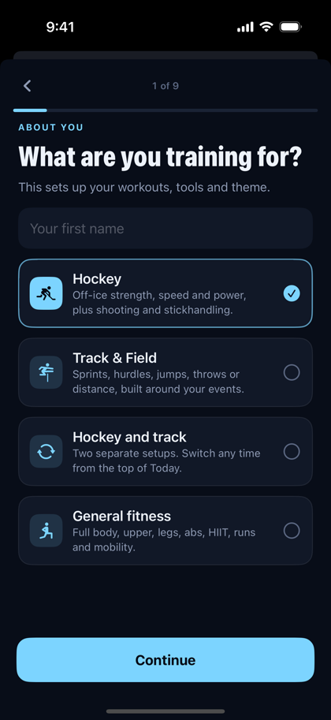
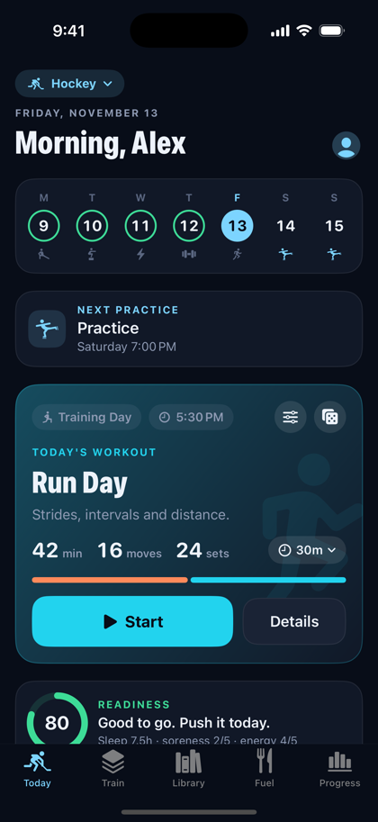
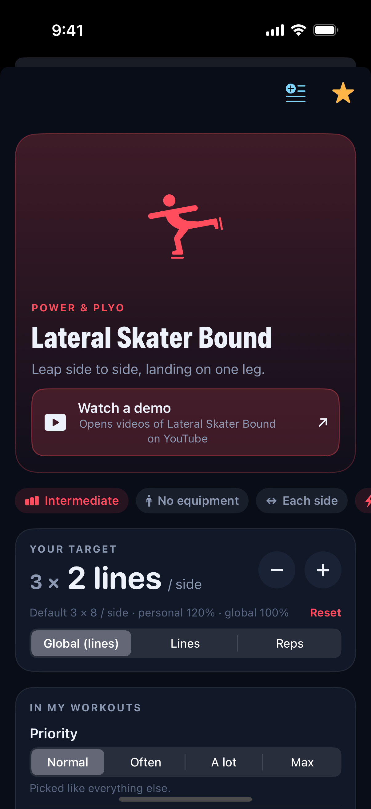
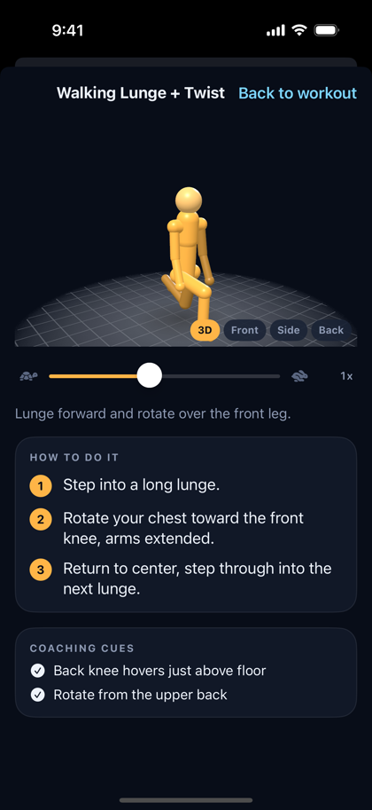
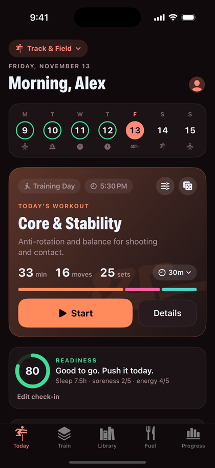
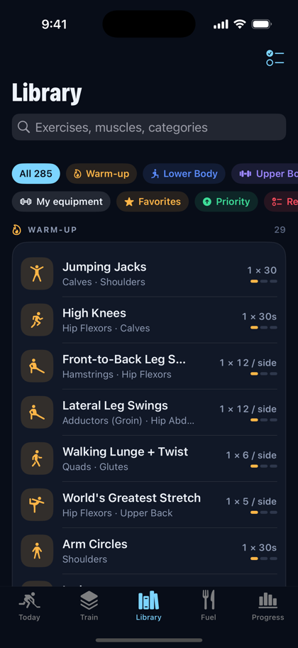
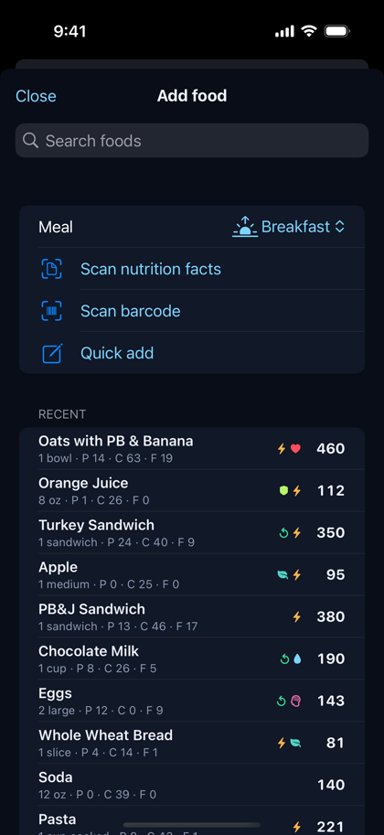
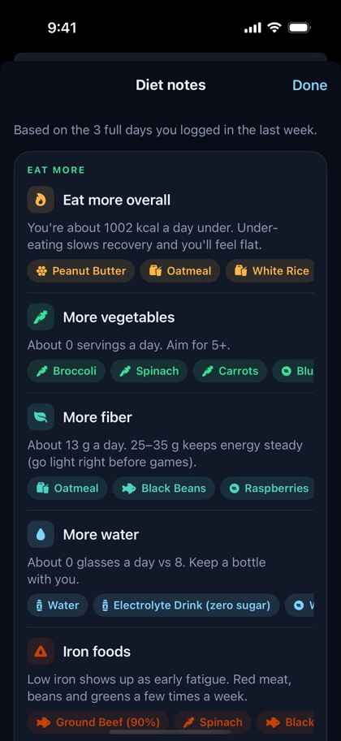

# Edgework

**A free training app for hockey players, track & field athletes and anyone who wants a real workout every day.** It generates a daily workout that fits your schedule, your equipment and your events, with step-by-step instructions and video demos for every exercise, plus food logging and GPS runs. SwiftUI, iOS 17+.

<p>
  
  
  
  
</p>
<p>
  
  
  
  
</p>

## Install

Edgework isn't on the App Store. Download `Edgework.ipa` from the [latest release](../../releases/latest) and sideload it with one of these:

- [AltStore](https://altstore.io) or [Sideloadly](https://sideloadly.io) with a free Apple ID. You have to re-sign every 7 days.
- A paid Apple Developer account or a signing service.
- [TrollStore](https://github.com/opa334/TrollStore), on supported iOS versions.

The app includes a widget extension (`com.obaba.edgework.widgets`) for the Home Screen widgets and the Lock Screen and Dynamic Island timers. The widgets read from the App Group `group.com.obaba.edgework` (AltStore and SideStore rename it, and the app picks that up). If your signer drops the extension or the App Group, the app still works. The widgets then say "Open Edgework to set up this widget".

## What's inside

**Daily workouts**
- A generator that rotates strength, power, speed, conditioning, core and mobility, picking whatever you've trained least recently.
- Adapts to game and meet days (short activation), the day after (recovery), practices and rest days. Or keep your normal workouts and train after the event, with less volume when you're sore.
- Review before starting: reorder, swap, refresh or remove anything. Global intensity slider plus −/+ on any single exercise, which the app remembers.
- Set any exercise's **priority** on a 7-step scale from Rarely to Max, with Normal in the middle, or make it **mandatory** (in every workout and program), from the Library. Mandatory shooting and stickhandling only join arm, hands, strength and full-body workouts, not leg or speed days.
- Line mode for travelling warm-ups (high knees, carioca, side lunges) instead of time.
- **Exercises I know**: 9 levels in 3 sections: the classics (push-ups, squats, high knees…), practice & gym moves (goblet squats, A-skips, dead bugs…) and specialised drills (Nordic curls, hurdle drills…), each with 3 levels. Setup has a quick test: tap the moves you know from 16 (two from each level 2-9), and it picks one of the 9 levels and adds any specific extra moves you picked. Retake it in Settings. This is about how familiar a move is, not how hard it is. **Study** (Library › Study) teaches you the rest one at a time with steps and a demo, and "Got it" adds that move to your workouts.
- Mandatory exercises always come last, in their own Mandatory section, in generated workouts, programs, your saved workouts and imported ones.

**Share**
- After a workout, a shot session or a hill run, make a share card for your Instagram or TikTok story (9:16) or a post (4:5). Progress › share makes a card of your week.
- Share any workout as a QR code or link. Teammates scan it with the iPhone Camera, or tap the link, and it opens in Edgework ready to save. Train › My workouts › Scan imports from a QR code or a pasted link. The whole workout is inside the link, so there's no server.

**Widgets**
- Home Screen and Lock Screen widgets show today's workout, your streak, today's shots and the next game.

**290+ exercises with instructions**
- Every exercise has written steps, coaching cues, a muscle map and why it helps.
- "Watch a demo" opens real form videos for that exercise on YouTube.
- Hill workouts (jog up & down, repeats, sprints, power walks, bounds) show up when you add Hill / Ramp to your equipment. They count trips, not time: up builds endurance, down trains you to catch yourself. Every climb is timed so you can see your uphill speed change, rep to rep and against last time.
- In the guided player, "How to" opens the steps without leaving your workout. The current set or rest timer shows on the Lock Screen and Dynamic Island. The "breathe" rest timer between sets can be turned off on the start screen or in Settings › Timer; then the next set starts as soon as you tap Done.

**Hockey**
- **Shooting** (Train › Shooting): the shot tracker, with two switches. **Aim trainer** calls a shot and a target for every puck. **Puck counter** plans rounds for the pucks you own, counts them back in after each bucket and catches lost ones; with the aim trainer on it switches the pickup stop on or off.
- **Siri**: "Hey Siri, open food in Edgework" (or Shooting, Study, Running, Stickhandling, Progress, Library, Train, Today, Settings), "start my workout in Edgework", "log shots in Edgework" (Siri asks how many), "log water in Edgework". They also show up in the Shortcuts app.
- Aim trainer with random or custom shot lists (shot type + target), using the same puck rounds as the counter. Every called shot counts toward today's shots. Tap Hit or Miss to build a heat map of your corners, by shot type.
- Wrist Rotation program: stick and dumbbell wrist rotations, stick levers, towel wrings and forearm work.
- Hands caller, shift timer and combine tests.
- Position-aware training for forwards, defense and goalies.

**Track & field**
- Pick your events in setup. Daily workouts and drill priorities are built around them: sprints, hurdles, distance, jumps, throws.
- Plans for the day before, the day of and the day after a meet, a meet-day checklist and a warm-up reminder.
- PRs per event, stopwatch, pace calculator, interval timer.

**Running**
- GPS runs with a live route map, pace, auto-pause, spoken splits and saved history.

**Fuel**
- 150+ built-in foods with what each helps (energy, recovery, iron and so on), plus Open Food Facts search.
- Scan a barcode or a nutrition label, from the camera or a photo. Scans are saved to My Foods.
- Customize any food and save your own version.
- Drinks are logged by volume, and water-like drinks count toward your water goal.
- Diet notes from your last week: what to eat more of, what to cut back on, and foods to try.
- A meal generator that uses your pantry.

**Schedule & reminders**
- Import any team calendar (TeamSnap, Crossbar, SportsEngine, Google…) by link or `.ics` file.
- Events are sorted with editable keyword lists (Settings › Schedule › Keywords) for games or meets, practices, meetings and things to ignore.
- Reminders for workout times by day, streak saver, water (your hours), runs, game lead time and meet warm-up.

**Progress**: streaks, charts, muscle heat map, history, benchmarks, JSON backup.

## Privacy

Everything stays on your phone, and there's no account and no analytics. The only network requests are food searches to Open Food Facts and the calendar link you add. "Watch a demo" just opens YouTube in your browser.

## Building

The project is generated with [XcodeGen](https://github.com/yonaskolb/XcodeGen):

```bash
brew install xcodegen
xcodegen generate
open Edgework.xcodeproj
```

CI (`.github/workflows/build.yml`) builds an unsigned IPA on every push to `main` and publishes it to the `latest` release. `screenshots.yml` runs the app in the simulator with demo data (`-demoData YES`, `-startTab N`, `-sport track`, `-showScreen <exercise-id | settings | howto | diet | …>`).

## Layout

```
Edgework/
  App/        entry point, tabs, debug launch hooks
  Models/     exercises, workouts, settings, sport profiles, food
  Data/       exercise library, track and hill libraries, programs, foods
  Engine/     workout generator
  Store/      persistence, scheduling, calendar, notifications, Live Activity
  UI/         theme, components, body map
  Views/      screens
EdgeworkWidgets/  Lock Screen + Dynamic Island
Shared/           code shared with the widget
tools/            icon renderer
```

## Credits & license

- Food data: [Open Food Facts](https://world.openfoodfacts.org), available under the [ODbL](https://opendatacommons.org/licenses/odbl/1-0/).
- Not medical advice. Warm up, and stop if something hurts.
- MIT licensed. See [LICENSE](LICENSE).
